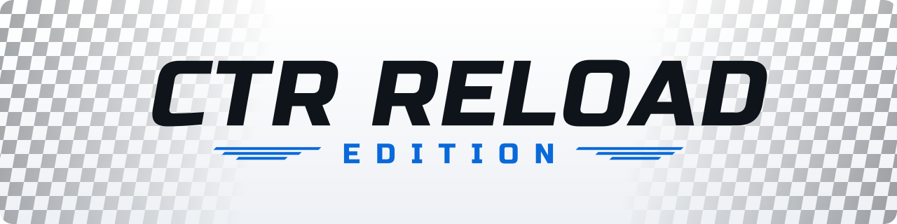

  <picture>
    <source media="(prefers-color-scheme: dark)" srcset="docs/assets/banner-dark.svg">
    <source media="(prefers-color-scheme: light)" srcset="docs/assets/banner-light.svg">
    
  </picture>

  <b>A PC edition of Crash Team Racing built for custom content — custom tracks and custom characters. 
  Built on <a href="https://github.com/CTR-tools/ctr-native">ctr-native</a>.</b>

  <!-- releases/latest is the newest full release; the nightly build is a pre-release and never "latest". -->
  
   
  Want the newest state? The <a href="https://github.com/LinksTech/CTR-Reload-Edition/releases/tag/nightly-builds">nightly build</a> is made from main every night - untested, no guarantees.

  
  
  
  

  <a href="#features">Features</a> &middot;
  <a href="#getting-started">Getting started</a> &middot;
  <a href="#controls">Controls</a> &middot;
  <a href="#custom-tracks">Custom tracks</a> &middot;
  <a href="#custom-characters">Custom characters</a> &middot;
  <a href="#mods">Mods</a> &middot;
  <a href="#coming-soon">Coming soon</a> &middot;
  <a href="#building-from-source">Building</a> &middot;
  <a href="#reporting-bugs">Bugs</a> &middot;
  <a href="#credits">Credits</a> &middot;
  <a href="#license-and-disclaimer">License</a>

CTR Reload Edition runs *Crash Team Racing* (PS1, 1999) natively on Windows,
without an emulator, and plays custom tracks and custom characters next to
the original ones.

It is a PC version, not a 1:1 port: the game logic of the original runs as
it is, and a native engine draws it the way a PC game can.

The current release is **0.7.5 Beta**. This README describes `main` (Reload
Studio 0.9.5): what is marked *new since 0.7.5* is in the
[nightly build](https://github.com/LinksTech/CTR-Reload-Edition/releases/tag/nightly-builds)
until the next release.

> [!IMPORTANT]
> You need **your own disc image** of the game, NTSC-U (SCUS-94426), as
> `.cue`/`.bin`. This repository and its releases contain **no game data**: no
> disc image, no extracted files, no models, textures, music or tracks. Apart
> from the bundled SDL library, they hold no 3D models, voices, sound effects
> or images made by other people either.

> [!WARNING]
> This is a **beta** for testing. Expect bugs - and please
> [report them](#reporting-bugs).

## Features

### 🎨 Graphics
- New Vulkan renderer
- *New since 0.7.5:* one-player races are drawn by the native engine -
  tracks, objects and drivers, hi-res drivers included. `--no-engine` goes
  back to the original PS1 drawing; races with two to four players use it
  as before
- Internal resolution up to 8x, MSAA anti-aliasing
- Real widescreen: 4:3, 16:9 and 21:9 — the view gets wider, nothing
  is stretched
- Menus stay nicely centered on ultrawide screens
- OPTIONS → GRAPHICS: display mode, aspect ratio, resolution,
  anti-aliasing and NATIVE DRIVERS, saved for the next start

### 🏁 Custom tracks — our main focus
- Drop a .rldtrack file into the tracks folder and it shows up in game
- New NITRO-PIT mode under Arcade with everything for custom tracks:
  - **Race**, with CPU drivers
  - **Time Trial** with your best times per track and lap count
  - **Custom cups** of four tracks each
  - **Crystal Challenge**: collect every crystal before the time runs out
  - **CTR Challenge**: finish 1st and collect C, T and R
- A track is listed under every mode it has the data for
- A preview video of each track plays in the track selection
- Tracks bring their own music and their own minimap, scaled
  automatically for the track screen
- *New since 0.7.5:* a track without a start grid gets one, and a track
  without CPU paths gets them generated from its checkpoints
- *New since 0.7.5:* up to 512 placed objects per track instead of 110
- Fixes for crashes found in community tracks, and broken track data
  gets caught before you race, not mid-race

### 🧑‍🚀 Custom characters
- Reload Studio asks *What do you want to build?* and guides you through
  one of three routes to a finished .rldchar and a test race:
  - **Vanilla**: a classic PS1-style driver from a glTF (.glb), OBJ or PLY
  - **Low-Poly** and **Hi-Res** *(new since 0.7.5)*: a textured driver
    from one .glb, animated with up to 12 clips on a skeleton - drawn by
    the game's new engine, with a classic model made from the same file as
    fallback
- **Creator Kit** *(new since 0.7.5)*: a ready Blender template made from
  your own game data - kart, skeleton, a placeholder figure and all 12
  clips. Swap in your figure, export, test
- Any model, exported at any scale, is fitted to Crash's size, repaired
  and, above the triangle limit, reduced automatically - the shape and the
  colours stay
- Your own icon in the driver select and the race HUD, mask (Aku Aku or
  Uka Uka), minimap colour, voice clips, shadow and exhaust
- The driving style (Balanced, Acceleration, Speed, Turning) decides how
  the kart drives and sounds
- Kart wheels drawn or hidden, or wheels of your own, with an extra rear
  wheel and the axles where you want them
- Drop a .rldchar file into the characters folder and it gets its own tile
  in the driver select - up to 32 of them - and can race as a CPU driver

### 🎛️ Mods (feature preview)
- A MODS page for one-player Arcade races and NITRO-PIT: choose your CPU
  drivers (random, or only the ones you tick - custom drivers too)
- *New since 0.7.5:* difficulty up to EXTREME, a one-on-one Boss Challenge
  against Ripper Roo, Papu Papu, Komodo Joe, Pinstripe or Nitros Oxide on
  any track, item chaos or your own item weights, gravity, grip, night and
  the Retro Fueled rules

### 🛠️ Reload Studio
- One window for tracks, cups and characters — no command line, no
  scripts, no patching
- Checks while you work and says in plain words what is wrong and how to
  fix it
- "Build container" also records the track's preview in the background
- 3D character preview next to Crash, the way the game will draw it, with
  its animations
- "Test in game" starts a race with your track or your character straight
  away
- Notices a new export by itself and checks again; long builds show their
  progress and can be cancelled
- *New since 0.7.5:* the Creator Kit inside the Character page, and
  modules - extra pages as DLLs in a `modules` folder next to the Studio
- Dark and light mode, follows the Windows display scale

### ⚙️ Under the hood
- Custom memory budget: big custom tracks get extra room (up to 32 MB),
  and buffers are sized per track. Original tracks keep their original
  tables, with larger draw and clip buffers
- New VRAM handling: palette textures go through a GPU atlas instead of
  being decoded from emulated PS1 VRAM for every pixel
- The native engine draws one-player levels with real textures and
  mipmaps, and high-detail and hi-res drivers with skinning; a level it
  cannot load falls back to the original PS1 drawing on its own
- Less emulation where it doesn't matter: several PS1 rendering steps
  now run natively, like transparency in a single pass
- Runs out of room gracefully: an effect is left out and logged instead
  of a crash

### ✨ Quality of life
- First-start window: just drag in your disc image
- Settings are remembered, faster boot
- *New since 0.7.5:* every key can be changed in OPTIONS → CONTROLS, and
  the mouse works in menus
- Race pauses when you alt-tab or minimize
- New main menu with Options (cheats, scrapbook) and Exit
- All characters unlocked from the start — your save stays untouched
- F12 saves a screenshot; F11 or Alt+Enter toggles full screen
- A log with date and time for every start, the last five are kept
- Folder and user names with any characters work (accents, Cyrillic ...)

## Getting started

1. Download **`ctr_native.exe`** (the game) and **`ReloadStudio.exe`** (the
   track and character tool) from the [latest release](https://github.com/LinksTech/CTR-Reload-Edition/releases/latest)
   into one folder you can write to, for example `C:\Games\CTR Reload` (not
   `C:\Program Files`).
2. Start `ctr_native.exe` and drag your disc image (`.cue` or `.bin`) onto the
   window. The game unpacks what it needs into an `assets` folder next to it,
   once.
3. Set up the picture in OPTIONS → GRAPHICS.
4. Create a folder `tracks` next to the game and put `.rldtrack` files into it.
5. Race them: ARCADE → NITRO-PIT → RACE, CUP, TIME TRIAL, CRYSTAL or CTR.
6. For custom characters, create a folder `characters` next to the game and
   put `.rldchar` files into it. They show up in the one-player ARCADE driver
   select, after the original drivers.

The game reads both folders when it starts: after a new track or character,
restart the game.

Windows 10 (1903 or newer) or Windows 11 and a graphics driver with Vulkan 1.0.

## Controls

Stock keyboard layout (the controller layout is fixed):

| Action | Key |
| --- | --- |
| Gas / confirm | C |
| Brake / back | X / Z |
| Steer, menu cursor | Left, Right, Up, Down |
| Jump and drift | Right Shift, Left Shift |
| Item | V |
| Rear view / camera | Right Ctrl / Left Ctrl |
| Start / select | Return / Space |

All keys can be changed in OPTIONS → CONTROLS: pick an action, press confirm,
then press the new key (Escape cancels). If another action of the same kind
had that key, the two swap. RESET TO DEFAULT brings the stock layout back.
Escape, F1-F12, Alt and the Windows keys cannot be bound.

The keys are saved in `ctr-controls.cfg` next to the game, one line per
action, for example `gas C`. A line the game cannot use is skipped with a line
in the log. Delete the file to get the stock layout back.

In menus the mouse works too: hover picks a row, left click confirms, right
click goes back, the wheel scrolls lists and changes values. It is not in the
driver, track and cup select yet, and not during a race.

## Custom tracks

Reload Studio (`ReloadStudio.exe`) builds a track container from your exported
track folder (`.lev`, `.vrm` and optional music), checks it and records its
preview. On its Cups page you put up to four cups together, and "Test in game"
starts a race on your track straight away. Keep it next to `ctr_native.exe`.

What a track needs for each mode

| Mode | Needs |
| --- | --- |
| Race | restart points (the checkpoints that count the laps); CPU paths are generated from them when the track has none (new since 0.7.5) |
| Crystal Challenge | at least one crystal |
| CTR Challenge | each of the letters C, T and R exactly once |
| Time Trial | the same as Race; its own row in NITRO-PIT |
| Battle | not available yet |

At most 512 placed objects (crates, fruit, letters and every other placed
model).

## Custom characters

On its Character page, Reload Studio first asks *What do you want to
build?* and then shows only the steps of that route - model, driver, in-game
look, voices and build - with the preview beside them. The shortest way is
four clicks: card, model, Build, Test in game.

| Route | Model | What the game draws |
| --- | --- | --- |
| **Vanilla** | glTF (.glb, recommended), OBJ or PLY | the classic PS1-style driver; animations from shape keys |
| **Low-Poly** *(new since 0.7.5)* | one .glb, its clips on a skeleton | a textured driver on a smaller budget (8000 triangles), and the classic fallback |
| **Hi-Res** *(new since 0.7.5)* | one .glb, its clips on a skeleton | a textured driver on the game's full hi-res budget, and the classic fallback |

Every model can be exported at any scale - it is fitted to Crash with his
kart, repaired (split corners, holes, faces turned inward) and, if it has
more triangles than a driver may draw, reduced until it fits. You choose the
driving style, the mask, an icon for the driver select and the race HUD, a
minimap colour, voice clips, shadow and exhaust, and the kart wheels: the
game's, none, or your own.

**Animations.** A Low-Poly or Hi-Res driver brings 12 clips as Blender
actions on its skeleton: `idle`, `steer_left`, `steer_right`, `jump`,
`drift_left`, `drift_right`, `hit`, `podium_1` to `podium_3`, `lose` and
`menu`. A missing clip falls back to another one, so you can start with a
few. A Vanilla driver takes shape keys instead (steer_left, steer_right,
reverse, crash, jump, win and lose) - see [docs/ANIMATIONS.md](docs/ANIMATIONS.md).

**Creator Kit** *(new since 0.7.5)*. Inside the Character page, the Creator
Kit builds a Blender 5.2 template from your own copy of the game: the kart, a skeleton, a
placeholder puppet and all 12 clips, with the export settings stored. You
replace the puppet with your figure, export it and test it - or start from
one of your old characters. Files with the kit's kart contain your game data
and stay on your computer; the figure alone is the file to share. The
step-by-step guide is [docs/CREATOR_KIT.md](docs/CREATOR_KIT.md).

In the preview, drag to turn the model, drag with the right mouse button to
move it, use the mouse wheel to zoom and double-click to go back to the start
view. The View menu (also on a right click) holds the fixed views, a light or
dark background, the Crash size reference, shadow and exhaust.

Current limits

- In the one-player ARCADE driver select, the NITRO-PIT race, cup and time
  trial, and as CPU drivers through MODS; not in NITRO-PIT CRYSTAL or CTR,
  Adventure, Battle or with two players
- At most 32 characters get a tile; their own icon shows for the first 20
- The size is visual only - physics and collision follow the driving style
- High score lists and profiles still show Fake Crash
- A driver without voice clips is silent
- The hi-res format is a preview and may still change

Every page and message of Reload Studio is explained in section 4 of the
[Reload Studio guide](tools/package/README.txt); what is new in each version
is in the [release notes](tools/package/RELEASE-NOTES.txt).

## Mods

MODS is a feature preview for one-player ARCADE races and cups, on the disc
tracks and in NITRO-PIT race and cup. In the track select press DOWN below
the last LAPS row (in the cup select, from a lower cup onto the MODS line),
then CROSS. Everything is off at first; with every value at normal the game
is exactly as before.

| Group | What you can set |
| --- | --- |
| Drivers | CPU drivers: default, all random or only the ones you tick (custom drivers too); difficulty EASY to EXTREME *(new since 0.7.5)*; Boss Challenge, one against one with a boss on any race track *(new since 0.7.5)* |
| Rules | items: default, chaos or your own weights; the Retro Fueled rules by TheRedhotbr, each on its own *(new since 0.7.5)* |
| World | gravity 20 % to 200 %, grip 0 % (ice) to 100 %, night 0 % to 90 % *(new since 0.7.5)* |

Not in CRYSTAL, CTR and TIME TRIAL of NITRO-PIT, Adventure, Battle or with
two players.

## Coming soon

In progress, in no particular order and without a date:

- Battle on custom tracks
- Custom characters in more modes: two players, Adventure and the NITRO-PIT
  challenges
- The native engine for races with two to four players
- More mods
- Skin support for the drivers

A new version comes out when enough has come together. Until then, fixes
and additions land here first.

## Building from source

Windows only, 32-bit (x86) build. You need:

- Visual Studio 2022 or Build Tools 2022 with *Desktop development with C++*
- CMake 3.21 or newer
- the Vulkan SDK (LunarG)
- Python 3.10 or newer (for the self-tests)

SDL3 and cgltf are part of the repository; there are no submodules.

From a command prompt in the repository root:

    build-msvc.bat

This configures, builds the Release configuration and runs the self-tests.
`ctr_native.exe` and `ReloadStudio.exe` end up in
`build-msvc-x86\Release\`. The same steps by hand:

    cmake --preset windows-msvc-x86
    cmake --build --preset windows-msvc-x86-release --parallel
    ctest --preset windows-msvc-x86-release

The self-tests need no game data. Details, tests and packaging are in
[BUILDING.md](BUILDING.md).

Quick states and replays exist only behind the developer switch `--dev`. They
are raw memory snapshots of the game: load only files you made yourself.

## Reporting bugs

Open an [issue](https://github.com/LinksTech/CTR-Reload-Edition/issues) with
the bug report template, one issue per problem.

What to include - and what never to attach

- The version: `ctr_native.exe --version`
- What happened, what you expected, and the steps to get there
- The newest log from the `logs` folder next to the game
- For a custom track or character: its file name and the SHA-256 Reload
  Studio shows

Issues are public: never attach disc images, the `assets` folder, memory cards,
`.rldtrack`/`.rldchar` files or other game data, and edit your Windows user
name out of the log if you mind.

## How this project is made

- Built on human-written foundations: ctr-native and the CTR-ModSDK
  decompilation.
- CTR Reload Edition is developed by two people. We write the code
  ourselves and together with Claude Code (Anthropic), decide what gets
  built, and review and test every change.
- Development happens openly and without fixed dates; how to contribute is
  described in [CONTRIBUTING.md](CONTRIBUTING.md).

## Credits

- [ctr-native](https://github.com/CTR-tools/ctr-native): the native PC port
  this edition is based on
- [CTR-ModSDK](https://github.com/CTR-tools/CTR-ModSDK): the decompilation
  project that ctr-native and this edition are built on
- **Sunset Vista by Tramadoll**: the track and its extras are Tramadoll's
  work. This repository only contains a compatibility layer
  (`game/native_trackmod.c`) so that the track runs natively in CTR Reload.
  The track itself is not included. Sunset Vista compatibility data used with
  permission of Tramadoll.
- **Retro-Fueled by TheRedhotbr** (CTR-ModSDK): the rules behind the Retro
  Fueled option of the MODS page.

Other components (PsyCross, SDL3 and more), the banner font and their licenses
are listed in [THIRD_PARTY_NOTICES.md](THIRD_PARTY_NOTICES.md).

## License and disclaimer

CTR Reload Edition is licensed under the
[GNU General Public License v3.0](LICENSE).

This is a non-commercial fan project. It is not affiliated with, endorsed by or
sponsored by Activision, Naughty Dog, Sony Interactive Entertainment or any
other rights holder. *Crash Team Racing* and *Crash Bandicoot* are trademarks
of their respective owners.
