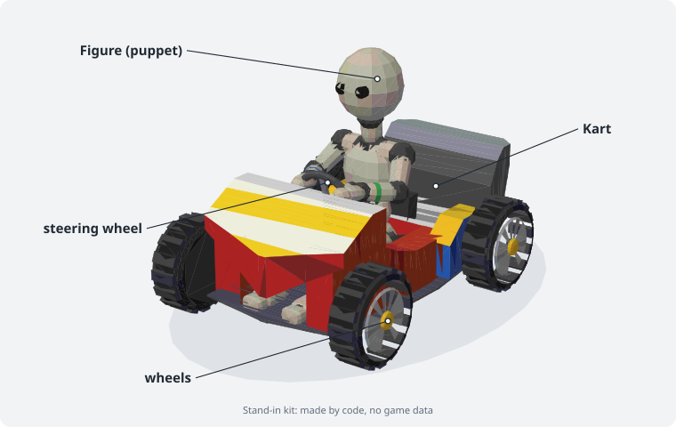
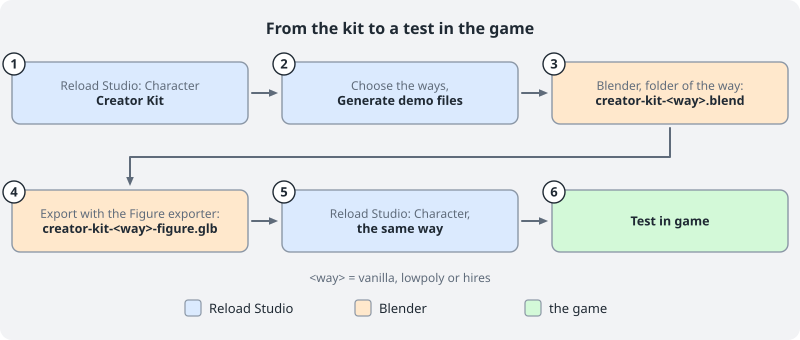
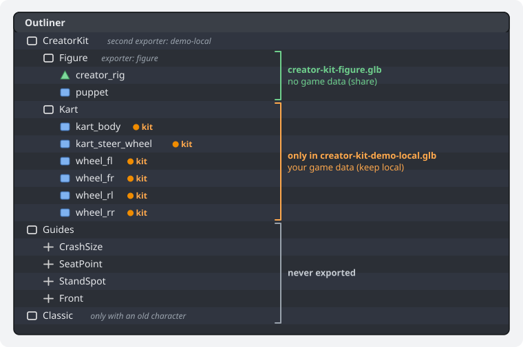
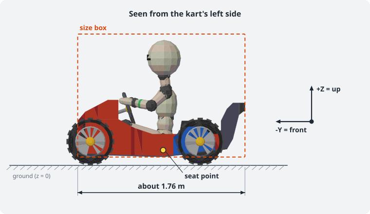
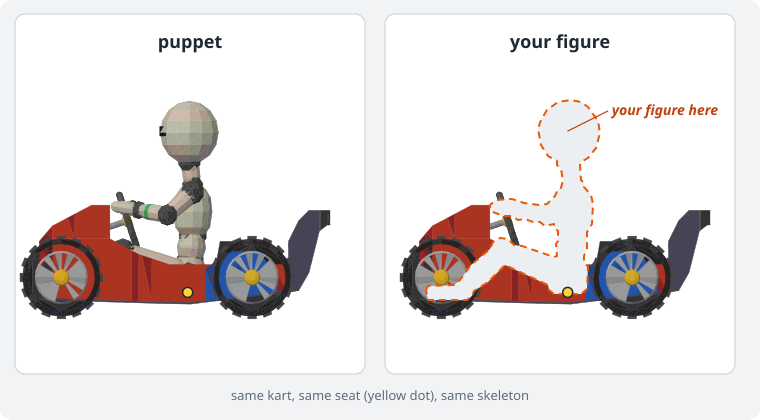
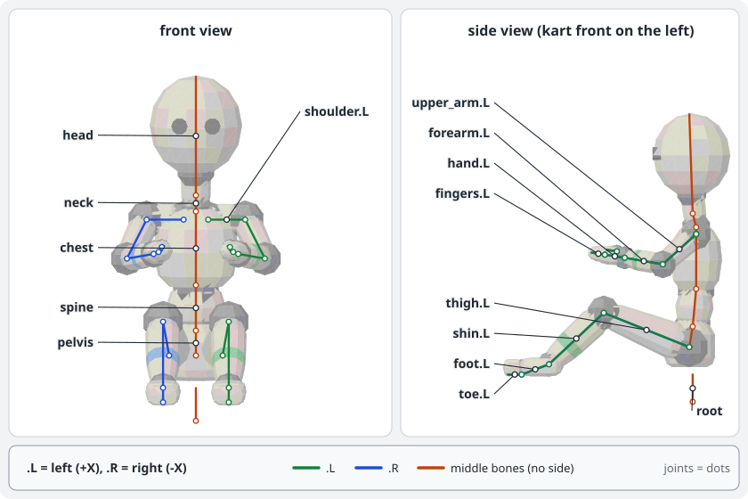
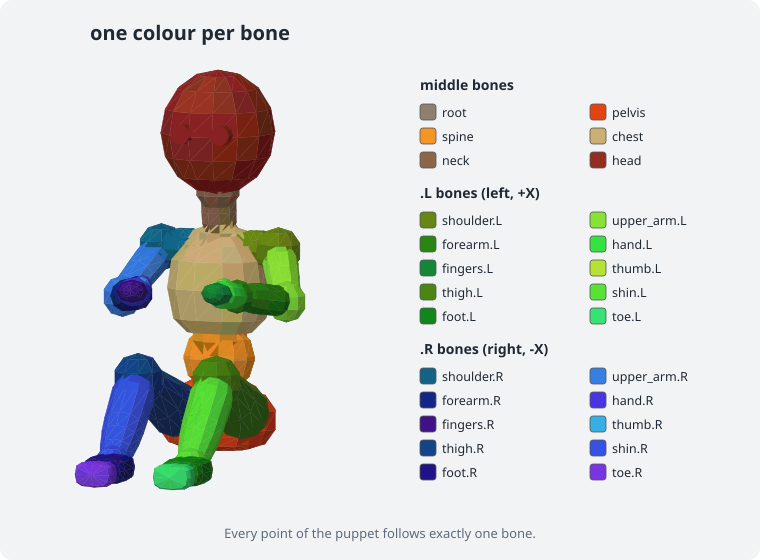
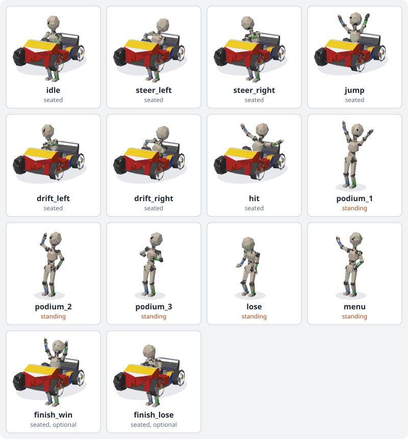
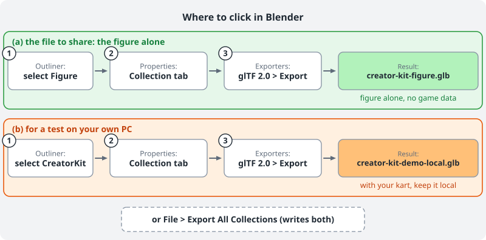

# Creator Kit

The Creator Kit helps you make a custom character with a skeleton and your own animations. You get a Blender file with a kart, a placeholder figure and all clips. You replace the figure, bind it to the skeleton, export it and test it in the game.

## What you get

The kit is made from your own copy of the game. It stays on your computer.

- A Blender file with the kart, four wheels and a placeholder figure, the **puppet**.
- A skeleton called `creator_rig` that fits the puppet.
- All 14 clips the game can play, two of them optional. They already work with the puppet.
- Export settings that are already stored in the file.

You replace the puppet with your own figure. You keep the skeleton, the clip names and the export settings.

## 1. Generate the demo files

You need **Blender 5.2**. Install Blender 5.2 from [blender.org](https://www.blender.org/download/). No other version is supported.

1. Start **Reload Studio**.
2. Open the page **Character**. On **Build a character**, click **Creator Kit** at the top right.
3. Choose your game data and the driver whose kart you want to use.
4. Choose an empty folder for the files.
5. Press the button **Generate demo files**.
6. Wait until the Studio says it is done. This takes a short while.

**Back** on the first step of the kit takes you back to the three ways of **Build a character**.

You find these files in the folder:

| File | What it is |
|---|---|
| `creator-kit.blend` | The Blender template. Open this one. |
| `creator-kit-figure.glb` | The demo export of the figure alone, with the puppet. It holds no game data. This is the file to share. |
| `creator-kit-demo-local.glb` | The figure with the kart and the wheels from your game data, for a test on your own computer. Never share it. |
| `creator-kit-report.json` | A short report of the run. |
| `kit-kart.glb` | The kart, taken from your game data. |
| `kit-wheel.glb` | The wheel, taken from your game data. |
| `kit-info.json` | Sizes and points of the kart: seat, steering wheel, wheels. |

The button **Guide** on the same page opens this guide.

## 2. Open the template

1. Open `creator-kit.blend` in Blender 5.2.
2. Look at the **Outliner**. It has these collections:
   - **CreatorKit** holds Figure and Kart. It has the exporter for the local demo file (section 7).
   - **Figure** holds `creator_rig` and the puppet. It is inside CreatorKit. It has the exporter for the figure alone (section 7).
   - **Kart** holds the kart body, the steering wheel and the four wheels. It is inside CreatorKit. These parts are marked as kit parts: they have a custom property `ctr_kit`, and their materials are named `ctrkit_...`.
   - **Guides** holds helper objects, for example the size box and the seat point. It is not exported.
   - **Classic** appears only when you load an old character (section 11). It is not exported.
3. The skeleton `creator_rig` is inside Figure.

The axes are fixed:

- The front of the kart points to **-Y**.
- **+Z** is up.
- The ground is at z = 0.
- 1 unit is 1 metre. The kart is about 1.76 m long.

Do not move or scale the kart. The game expects it where it is.

## 3. Put your own figure in place of the puppet

1. In the Outliner, **hide** the object `puppet`. Do not delete it yet. You need it as a guide until your figure is bound.
2. Bring your figure into Blender and move it into the collection **Figure**.
3. Model or move the figure so that it **sits** in the kart:
   - The hips rest on the seat point.
   - The hands reach the steering wheel.
   - The feet stay inside the kart.
   - The head stays inside the size box in **Guides**.
4. Apply the scale of your figure (Object > Apply > Scale) so that it is 1 on all axes.
5. Make sure the figure has UVs and a material with a texture.

Keep the kit parts in the collection **Kart**. Do not move them into **Figure**. Reload Studio warns you about a file that contains them: "This file contains the original kart from your game data. Don't share it, or export without the kart."

Keep to these limits:

- At most **64000 triangles** for the whole file. The kart and the wheels use a part of that.
- At most **62 materials**.
- Texture edge at most **2048** pixels. All textures together should stay under **32 MiB**.
- The whole model must be smaller than **4 m** in every direction in every pose.
- At most **4 bone weights** per vertex.
- At most **64 bones** in total.

## 4. Bind your figure to the skeleton

The skeleton fits the puppet. Move it to fit your figure.

1. Select `creator_rig` and enter **Edit Mode**.
2. Move each bone to the matching joint of your figure. Use the puppet as a guide.
3. Leave Edit Mode.
4. **Keep the skeleton's rest pose seated.** Do not make the figure stand. The rest pose is the seated pose in the kart.
5. Select your figure, then `creator_rig`. Use **Object > Parent > With Automatic Weights**.
6. Open **Weight Paint** and check the weights. Fix places where the skin bends badly, for example shoulders and hips.
7. Keep at most 4 bones per vertex. Use **Weights > Limit Total** with the value 4.
8. Bones end in `.L` (left) or `.R` (right). Blender can mirror weights and poses for you, because of these names.
9. When your figure moves well, delete the puppet.

You may add your own bones, for example for ears, hair or a tail. Keep the total at 64 bones or fewer. Do not rename or delete the existing bones. Their names are:

`root`, `pelvis`, `spine`, `chest`, `neck`, `head`, `shoulder`, `upper_arm`, `forearm`, `hand`, `fingers`, `thumb`, `thigh`, `shin`, `foot`, `toe`, `kart` and `kart_steer`. All but `root`, `pelvis`, `spine`, `chest`, `neck`, `head`, `kart` and `kart_steer` come as a `.L` and a `.R` bone.

The bones `kart` and `kart_steer` belong to the kart. The kart body and the wheels hang on `kart`, the steering wheel on `kart_steer`, which turns it. No vertex of your figure gets weight from them.

## 5. The clips

The game plays 14 clips. Two of them, `finish_win` and `finish_lose`, are optional. Each clip is one **action** in Blender. The game finds a clip by its name, so use the names exactly as written.

| Name | When the game plays it | Pose | Type | Length |
|---|---|---|---|---|
| `idle` | Driving straight, and waiting at the start | Seated in the kart | Loop | 2.0 s |
| `steer_left` | Steering left. The more you steer, the further the clip runs. | Seated in the kart | Steering pose | 0.5 s |
| `steer_right` | Steering right | Seated in the kart | Steering pose | 0.5 s |
| `jump` | In the air after a jump | Seated in the kart | Once | 0.6 s |
| `drift_left` | Drifting to the left | Seated in the kart | Loop | 1.0 s |
| `drift_right` | Drifting to the right | Seated in the kart | Loop | 1.0 s |
| `hit` | After a hit | Seated in the kart | Once | 1.0 s |
| `podium_1` | First place on the podium | Standing, no kart | Loop | 2.0 s |
| `podium_2` | Second place on the podium | Standing, no kart | Loop | 2.0 s |
| `podium_3` | Third place on the podium | Standing, no kart | Loop | 2.0 s |
| `lose` | Fourth place or worse, where the game shows the figure without kart | Standing, no kart | Loop | 2.0 s |
| `menu` | In the character select | Standing, no kart | Loop | 3.0 s |
| `finish_win` | After the finish line on places 1 to 3, while the kart drives on (optional) | Seated in the kart | Loop | 2.0 s |
| `finish_lose` | After the finish line on place 4 or worse, while the kart drives on (optional) | Seated in the kart | Loop | 2.0 s |

The game hides the kart in the podium scene and in the character select. So the four podium clips, `lose` and `menu` are standing clips. While you work on a standing clip, **hide the collection Kart** in the Outliner.

**Loop** means the clip repeats. **Once** means the game plays it one time and holds the last pose. **Steering pose** means the game picks a point in the clip by how far the player steers.

To work with the clips:

1. Select `creator_rig` and enter **Pose Mode**.
2. Open the **Action Editor** (in the Animation workspace, or change an editor to Dope Sheet > Action Editor).
3. Choose a clip from the action list. The pose of your figure changes.
4. The clips of the puppet work at once with your figure, because the bones are the same. Check each clip.
5. To change a clip, move bones in Pose Mode and insert keys (I). Or key a new clip from scratch.

Follow these rules:

- Use the **exact names** from the table. A misspelled name is not found.
- **Loops end as they begin.** The last pose must match the first pose.
- **Steering clips start at the neutral pose and end at full lock.** The first pose is the same as `idle` at the start. The last pose is the figure turned fully into the curve. The motion goes in one direction.
- **No moving away.** The figure stays over its spot in the kart. Do not move `root`. A standing clip lifts `pelvis` up to the standing height, nothing more.
- **Hands stay on the wheel** in `idle`, the steering clips and the drift clips. The steering wheel turns with the bone `kart_steer`. In `finish_win` the hands may leave the wheel.
- **The finish clips are seated.** The hips stay on the seat, as in the race clips.
- A standing clip puts the feet on the ground at z = 0, where the kart was.

If a clip is missing, the game uses another one:

- `steer_left`, `steer_right`, `jump`, `hit`, `lose` and `menu` use `idle`.
- `drift_left` uses `steer_left` at full lock. `drift_right` uses `steer_right` at full lock.
- `podium_1` uses `idle`. `podium_2` uses `podium_1`. `podium_3` uses `podium_2`.
- If `idle` is missing, the rest pose is used. This is the seated pose.
- `finish_win` and `finish_lose` are optional. A file without them is fine. Without them the game plays what earlier versions played after the finish line. Files from this kit keep the seated race clips. An older file without the kart part plays `podium_1`, `podium_2` or `podium_3` (places 1 to 3) or `lose`.

You can start with fewer clips and add the rest later.

## 6. Vertex colours

The mode of the vertex colours is written at the end of every material name. There are three modes:

- `[vcol psx]` is the PS1 style. A vertex colour of grey 128 keeps the texture as it is. Darker shades make it darker. Lighter shades make it brighter. The game draws the whole model **without extra light**. The shading is in the colours.
- `[vcol gltf]` is the glTF style. White keeps the texture as it is. The game lights the model.
- `[vcol off]` ignores the vertex colours. The game lights the model.

All materials of one file must have the same mode. The demo files are made in PSX mode by default. The Studio can make the other two modes.

When your figure is new, choose one of these:

1. **PSX mode:** give your figure vertex colours. Use grey 128 as the neutral value. Paint lighter colours where light falls and darker colours in the shade. Then the figure matches the kart.
2. **glTF mode:** keep the vertex colours white or remove them. Then the game lights the figure. The Studio can make the kit in glTF mode.

To use another mode, make the demo files again in that mode. The colours of the kart are made for one mode, so only renaming the materials is not enough.

## 7. Export

The export settings are already stored in the file.

There are two exporters:

- The collection **Figure** writes `creator-kit-figure.glb`. This is the figure alone. It holds no game data. This is the file to share.
- The collection **CreatorKit** writes `creator-kit-demo-local.glb`. This is the figure with the kart and the wheels from your own game data. Use it for a test on your own computer. Never share it.

To export:

1. Select the collection in the Outliner.
2. Open its Collection properties > **Exporters** > **glTF 2.0** > **Export**.
   Or use **File > Export All Collections**. This writes both files next to the .blend file.
3. You may use other file names.

> Do not change the export settings. Especially keep **Animations** on. Without it the file has no clips.

## 8. Character

1. Start Reload Studio and open the page **Character**.
2. Choose your .glb file as the model. For a test on your own computer, section 10 names the file to use.
3. The Studio checks the file. It shows the animations: which clips come from the file and which use a fallback. It also shows the budget: triangles, joints, materials and textures.
4. Check the vertex colour mode. It must match the ending of your material names.
5. Fix every error the Studio shows. A warning means that the character works, but something falls back to a standard.

## 9. The classic model

Older versions of the game and the PS1 path cannot show a skeleton. The Studio builds a **classic model** for them from your file, automatically.

- The Studio reads your model as it stands in its **bind pose**. It ignores the skeleton and the clips.
- The figure file has no kart of its own. From format 4.3 the game puts the original kart from the player's game data under the classic model too. A game before 4.3, or a game without that game data, shows it in a plain grey kart.
- This is why you bind your figure **seated in the kart**. A standing figure gives a bad classic model.
- The game makes the classic steering and jump poses itself.

For advanced users, this is the same step on the command line:

`ReloadStudio.exe --rldpack make-char --model creator-kit-figure.glb --reduce auto --rig bind-pose --figure-only`

You do not need this for normal work.

## 10. Test in game

The figure alone holds no game data. The game adds the original kart to it from the player's own game. So you can test `creator-kit-figure.glb` as it is, and share it as it is.

1. On the page **Character**, choose the file named above. Then press the button **Test in game**.
2. Start a race with your character.
3. Check these things:
   - Driving straight: the figure sits well and the hands are on the wheel.
   - Steering both ways: the figure leans and turns with the wheel.
   - Drifting both ways.
   - A jump.
   - Getting hit.
   - After the finish line: `finish_win` or `finish_lose`, if your file has them.
4. Finish the race and check the podium. The figure stands without the kart.
5. Open the character select. The figure stands there without the kart.

If something looks wrong, go back to Blender, fix it, export again and test again.

## 11. Start from an old character

You can start from a character you made before (a .rldchar file).

1. Open the Creator Kit (page **Character**, **Build a character**, **Creator Kit** at the top right). Choose the old character at **Start from an old character**.
2. Press **Generate demo files**.
3. Open `creator-kit.blend`. The old model is in the collection **Classic**. Click the eye of Classic in the Outliner to show it.

The old model has the right size and sits where the puppet sits. When the file has a native model with textures, you get that one. Else you get the classic model with its vertex colours.

- Use it as a guide, or move parts of it into **Figure** and bind them to the skeleton (section 4).
- The collection **Classic** itself is never exported.
- Its objects and materials are named `classic_...`.

## 12. Sharing

Share only files without the kit kart. The game puts the kart in on the player's side.

From format 4.3 the game puts the original kart from the player's game data in for both models: the hi-res figure and the classic model. A game before 4.3 shows the classic model in a plain grey kart.

## 13. If something is wrong

- **A clip is missing or not found.** The name is misspelled or the action is missing. Open the Action Editor and compare the name with the table in section 5. The names are exact and in lower case.
- **The Studio says the file contains the original kart from your game data.** For sharing, export with the exporter of the collection Figure (`creator-kit-figure.glb`). Keep the other file for yourself. Check that no kit part was moved into Figure.
- **The wheels are missing.** The wheel objects are not inside the collection Kart, or Kart is not inside CreatorKit. Move them back.
- **Too many triangles.** Reduce the figure. Use the Decimate modifier, apply it, and bind the figure again. Remember that the kart and the wheels also use triangles.
- **The figure is too big.** Check the size box in Guides. The figure should fit inside it when it sits. Scale it, then apply the scale.
- **The figure looks too dark or too bright.** Check the vertex colour mode in the material names (section 6). In PSX mode the neutral value is grey 128. In glTF mode it is white.
- **In a race the figure stands inside the kart.** The skeleton's rest pose is standing. Make the rest pose seated and bind the figure again.
- **On the podium the figure floats or sinks.** In the standing clips, the feet must be on the ground at z = 0. Fix the height of `pelvis` in the clip.
- **The export has no animations.** The setting Animations was turned off. Do not change the export settings. Open the Exporters panel of CreatorKit and turn **Animations** on again.
