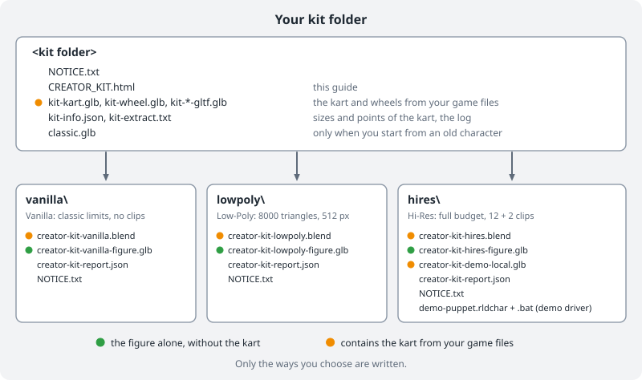

# Creator Kit

The Creator Kit gives you Blender templates for a character of your own, one for each way of **Build a character**: **Vanilla**, **Low-Poly** and **Hi-Res**. Each template has the kart, a placeholder figure with a skeleton and an export that is already set up. You replace the figure, export it and build it on the page **Character** with the same way.

## The notice

The kit writes this notice as `NOTICE.txt` into the kit folder and into the folder of each way. Reload Studio shows it above the button **Generate demo files**.

> The kart and wheels are generated on this PC from your own game files.
> The template exports only your character, and every player gets the
> kart from their own game.
>
> CTR Reload is not responsible for files you share.
>
> Requirements: Blender 5.2 and your own copy of the original game, set
> up for CTR Reload.

## What you get

The kit is made on this PC from your own game files.

- One Blender template per way you choose, each in its own folder.
- In each template: the kart, four wheels and a placeholder figure, the **puppet**.
- A skeleton called `creator_rig` that fits the puppet.
- The clips the way plays (section 6). They already work with the puppet.
- An export that is already stored in the file. It writes your figure alone, without the kart.

You replace the puppet with your own figure. You keep the skeleton, the clip names and the export settings.

## 1. Where the kit is

You need **Blender 5.2**. Install Blender 5.2 from [blender.org](https://www.blender.org/download/). No other version is supported.

There are two ways into the kit:

- Open the page **Character**. On **Build a character**, click **Creator Kit** (*Templates to get started*) at the top right.
- On the step **Model** of any of the three ways, while no model is chosen, click **No model yet? Start with the Creator Kit.** The kit opens with that way chosen. You can change the choice in the kit.

**Back** on the first step of the kit takes you back to the three ways of **Build a character**.

## 2. Generate the demo files

The kit has five steps:

1. **What you get** says what the kit makes. The button **Guide** opens this guide.
2. **What the kit needs** checks your game data and Blender 5.2.
3. **Where the kit goes**:
   - Choose a folder for the kit.
   - Choose the ways: **All three ways** (the default), or only **Vanilla**, **Low-Poly** or **Hi-Res**.
   - With **Hi-Res** chosen you can also build a demo driver to try in the game right away.
   - Optional: **Start from an old character** (section 12).
4. **Generate** shows the notice. Press **Generate demo files** and wait until the Studio says it is done. This takes a short while.
5. **Your kit** lists the files. **Open the template in Blender** opens it, **Show in folder** shows the folder, **Go to Character** goes to the page Character.

## 3. The kit folder

Only the ways you choose are written. In the kit folder:

| File | What it is |
|---|---|
| `NOTICE.txt` | The notice above. |
| `CREATOR_KIT.html` | This guide. |
| `kit-kart.glb`, `kit-wheel.glb`, `kit-kart-gltf.glb`, `kit-wheel-gltf.glb` | The kart and the wheel, from your game files. |
| `kit-info.json` | Sizes and points of the kart: seat, steering wheel, wheels. |
| `kit-extract.txt` | The log of reading the kart from your game files. |
| `scripts` | The scripts that made the templates, and the notice they write. |
| `classic.glb` | Your old character, only when you start from one (section 12). |

In each folder of a way, `vanilla`, `lowpoly` and `hires`:

| File | What it is |
|---|---|
| `creator-kit-<way>.blend` | The Blender template of the way. Open this one. It contains the kart from your game files. |
| `creator-kit-<way>-figure.glb` | The demo export of the figure alone, with the puppet. It has no kart and nothing from your game files. |
| `NOTICE.txt` | The notice above. |
| `creator-kit-report.json` | A short report of the run. |

The folder `hires` has one more file, `creator-kit-demo-local.glb`: the figure with the kart and the wheels from your game files, for a test on your own computer. With the demo driver it also has `demo-puppet.rldchar` and a .bat file that starts the game with it.

## 4. The three ways

Each way has its own template. The skeleton and the steps in Blender are the same. The puppet, the limits, the clips and the export differ.

### Vanilla

The Vanilla way builds a classic character, the kind the original game draws. It runs everywhere, also on the PS1 path.

- **Triangles:** the original drivers have up to about **560 triangles**, kart included. The Vanilla puppet has 543. More is possible: the Studio notes it, and from about **7200 triangles** on it reduces the model for you.
- **Colours:** at most **96 colours** for the figure. The game keeps the rest of its 128 colours for the kart. The Studio merges more colours and says so in a warning.
- **Textures:** the classic model draws no textures. Each triangle takes its colours from the texture at its three corners. Large flat colour fields work best; a detailed texture can make the Studio split triangles.
- **Thin parts:** positions are stored coarsely. Very thin parts can collapse; the Studio warns about them.
- Vertex colours in PSX mode (section 7).
- The skeleton is there so that you can pose the figure while you model it. The export has **no skin and no clips**: the classic model makes its steering and jump poses by itself.
- The game puts in the kart from the player's game data. On the step **Model** the Studio sets **Kart** to the player's game data under **Advanced** and says so in one line on the step. **Change** opens Advanced.

### Low-Poly

The Low-Poly way builds a modern, stylised character with clear surfaces.

- **Limits:** at most **8000 triangles** and textures of at most **512 pixels**. Above that, the Studio warns and suggests Hi-Res. The Low-Poly puppet has about 5300 triangles.
- Vertex colours in PSX mode (section 7).
- The clips of section 6: the 12 clips the game plays and the 2 optional finish clips.

### Hi-Res

The Hi-Res way builds a character in full quality with animations.

- **Limits:** the full budget of the game (below).
- The Hi-Res puppet stays at about **14500 triangles**, so that the Studio can make the classic fallback (at most 7200 triangles, section 10) from it. The budget of the way is higher.
- A Hi-Res model of more than about 20000 triangles that uses the game's kart can stop at "could not be reduced automatically to 7200 triangles" when the Studio builds its classic fallback. Reducing the model in Blender (Decimate) or giving it a kart part avoids that.
- Vertex colours in PSX mode (section 7), as in the other two templates.
- The material of the puppet has a **normal map**, made by code. Replace it with your own, or remove it.
- All **12 clips** and the 2 finish clips `finish_win` and `finish_lose` (section 6).
- A second exporter writes `creator-kit-demo-local.glb`, the figure with the kart, for a test on your own computer (section 8).

### The budget of the game

These limits hold for every Low-Poly and Hi-Res file:

- At most **64000 triangles** for the whole file. The kart and the wheels use a part of that.
- At most **62 materials**.
- Texture edge at most **2048** pixels. All textures together should stay under **32 MiB**.
- The whole model is smaller than **4 m** in every direction in every pose.
- At most **4 bone weights** per vertex.
- At most **64 bones** in total.

## 5. Open the template and put your figure in place

1. Open `creator-kit-<way>.blend` of your way in Blender 5.2, for example `hires\creator-kit-hires.blend`.
2. Look at the **Outliner**. It has these collections:
   - **CreatorKit** holds Figure and Kart. In the Hi-Res template it has the exporter for the local demo file (section 8).
   - **Figure** holds `creator_rig` and the puppet. It is inside CreatorKit. It has the exporter for the figure alone (section 8).
   - **Kart** holds the kart body, the steering wheel and the four wheels. It is inside CreatorKit. These parts are marked as kit parts: they have a custom property `ctr_kit`, and their materials are named `ctrkit_...`.
   - **Guides** holds helper objects, for example the size box and the seat point. It is not exported.
   - **Classic** appears only when you load an old character (section 12). It is not exported.

The axes are fixed:

- The front of the kart points to **-Y**.
- **+Z** is up.
- The ground is at z = 0.
- 1 unit is 1 metre. The kart is about 1.76 m long.

Leave the kart where it is, at its size. The game expects it there.

1. In the Outliner, **hide** the object `puppet`. Keep it until your figure is bound: it is your guide.
2. Bring your figure into Blender and move it into the collection **Figure**.
3. Model or move the figure so that it **sits** in the kart:
   - The hips rest on the seat point.
   - The hands reach the steering wheel.
   - The feet stay inside the kart.
   - The head stays inside the size box in **Guides**.
4. Apply the scale of your figure (Object > Apply > Scale) so that it is 1 on all axes.
5. Make sure the figure has UVs and a material with a texture.
6. Keep to the limits of your way (section 4).

The kit parts stay in the collection **Kart**, not in **Figure**. For a file that contains them, Reload Studio shows the warning "This file contains the kart from your game files."

### Bind your figure to the skeleton

The skeleton fits the puppet. Move it to fit your figure.

1. Select `creator_rig` and enter **Edit Mode**.
2. Move each bone to the matching joint of your figure. Use the puppet as a guide.
3. Leave Edit Mode.
4. **Keep the skeleton's rest pose seated.** The rest pose is the seated pose in the kart, not a standing one.
5. Select your figure, then `creator_rig`. Use **Object > Parent > With Automatic Weights**.
6. Open **Weight Paint** and check the weights. Fix places where the skin bends badly, for example shoulders and hips.
7. Keep at most 4 bones per vertex. Use **Weights > Limit Total** with the value 4.
8. Bones end in `.L` (left) or `.R` (right). Blender can mirror weights and poses for you, because of these names.
9. When your figure moves well, delete the puppet.

You may add your own bones, for example for ears, hair or a tail. Keep the total at 64 bones or fewer. Keep the names of the existing bones and keep them all. Their names are:

`root`, `pelvis`, `spine`, `chest`, `neck`, `head`, `shoulder`, `upper_arm`, `forearm`, `hand`, `fingers`, `thumb`, `thigh`, `shin`, `foot`, `toe`, `kart` and `kart_steer`. All but `root`, `pelvis`, `spine`, `chest`, `neck`, `head`, `kart` and `kart_steer` come as a `.L` and a `.R` bone.

The bones `kart` and `kart_steer` belong to the kart. The kart body and the wheels hang on `kart`, the steering wheel on `kart_steer`, which turns it. No vertex of your figure gets weight from them.

## 6. The clips

This section is for Low-Poly and Hi-Res. A Vanilla export has no skin and no clips.

The game plays 14 clips. Two of them, `finish_win` and `finish_lose`, are optional. Each clip is one **action** in Blender. The game finds a clip by its name, so use the names exactly as written.

| Name | When the game plays it | Pose | Type | Length |
|---|---|---|---|---|
| `idle` | Driving straight, and waiting at the start | Seated in the kart | Loop | 2.0 s |
| `steer_left` | Steering left. The more you steer, the further the clip runs. | Seated in the kart | Steering pose | 0.5 s |
| `steer_right` | Steering right | Seated in the kart | Steering pose | 0.5 s |
| `jump` | In the air after a jump | Seated in the kart | Once | 0.6 s |
| `drift_left` | Drifting to the left | Seated in the kart | Loop | 1.0 s |
| `drift_right` | Drifting to the right | Seated in the kart | Loop | 1.0 s |
| `hit` | After a hit | Seated in the kart | Once | 1.0 s |
| `podium_1` | First place on the podium | Standing, no kart | Loop | 2.0 s |
| `podium_2` | Second place on the podium | Standing, no kart | Loop | 2.0 s |
| `podium_3` | Third place on the podium | Standing, no kart | Loop | 2.0 s |
| `lose` | Fourth place or worse, where the game shows the figure without kart | Standing, no kart | Loop | 2.0 s |
| `menu` | In the character select | Standing, no kart | Loop | 3.0 s |
| `finish_win` | After the finish line on places 1 to 3, while the kart drives on (optional) | Seated in the kart | Loop | 2.0 s |
| `finish_lose` | After the finish line on place 4 or worse, while the kart drives on (optional) | Seated in the kart | Loop | 2.0 s |

The game hides the kart in the podium scene and in the character select. So the four podium clips, `lose` and `menu` are standing clips. While you work on a standing clip, **hide the collection Kart** in the Outliner.

**Loop** means the clip repeats. **Once** means the game plays it one time and holds the last pose. **Steering pose** means the game picks a point in the clip by how far the player steers.

To work with the clips:

1. Select `creator_rig` and enter **Pose Mode**.
2. Open the **Action Editor** (in the Animation workspace, or change an editor to Dope Sheet > Action Editor).
3. Choose a clip from the action list. The pose of your figure changes.
4. The clips of the puppet work at once with your figure, because the bones are the same. Check each clip.
5. To change a clip, move bones in Pose Mode and insert keys (I). Or key a new clip from scratch.

Follow these rules:

- Use the **exact names** from the table. A misspelled name is not found.
- **Loops end as they begin.** The last pose matches the first pose.
- **Steering clips start at the neutral pose and end at full lock.** The first pose is the same as `idle` at the start. The last pose is the figure turned fully into the curve. The motion goes in one direction.
- **The figure stays over its spot in the kart.** `root` stays where it is. A standing clip lifts `pelvis` up to the standing height, nothing more.
- **Hands stay on the wheel** in `idle`, the steering clips and the drift clips. The steering wheel turns with the bone `kart_steer`. In `finish_win` the hands may leave the wheel.
- **The finish clips are seated.** The hips stay on the seat, as in the race clips.
- A standing clip puts the feet on the ground at z = 0, where the kart was.

If a clip is missing, the game uses another one:

- `steer_left`, `steer_right`, `jump`, `hit`, `lose` and `menu` use `idle`.
- `drift_left` uses `steer_left` at full lock. `drift_right` uses `steer_right` at full lock.
- `podium_1` uses `idle`. `podium_2` uses `podium_1`. `podium_3` uses `podium_2`.
- If `idle` is missing, the rest pose is used. This is the seated pose.
- `finish_win` and `finish_lose` are optional. A file without them is fine. Without them the game plays what earlier versions played after the finish line. Files from this kit keep the seated race clips. An older file without the kart part plays `podium_1`, `podium_2` or `podium_3` (places 1 to 3) or `lose`.

You can start with fewer clips and add the rest later.

## 7. Vertex colours

The mode of the vertex colours is written at the end of every material name. There are three modes:

- `[vcol psx]` is the PS1 style. A vertex colour of grey 128 keeps the texture as it is. Darker shades make it darker. Lighter shades make it brighter. The game draws the whole model **without extra light**. The shading is in the colours.
- `[vcol gltf]` is the glTF style. White keeps the texture as it is. The game lights the model.
- `[vcol off]` ignores the vertex colours. The game lights the model.

All materials of one file have the same mode. All three templates are in PSX mode.

When your figure is new, choose one of these:

1. **PSX mode:** give your figure vertex colours. Use grey 128 as the neutral value. Paint lighter colours where light falls and darker colours in the shade. Then the figure matches the kart.
2. **glTF mode:** keep the vertex colours white or remove them. Then the game lights the figure.

The colours of the kart are made for one mode, so renaming the materials alone does not change the mode of a template.

## 8. Export

The export settings are already stored in the file.

- In every template the collection **Figure** writes `creator-kit-<way>-figure.glb`, for example `creator-kit-lowpoly-figure.glb`. This is the figure alone, without the kart.
- In the Hi-Res template the collection **CreatorKit** also writes `creator-kit-demo-local.glb`. This is the figure with the kart and the wheels from your game files, for a test on your own computer.

To export:

1. Select the collection in the Outliner.
2. Open its Collection properties > **Exporters** > **glTF 2.0** > **Export**.
   Or use **File > Export All Collections**. This writes every exporter of the file next to the .blend file.
3. You may use other file names.

> Leave the export settings as they are. In Low-Poly and Hi-Res, **Animations** is on: without it the file has no clips. In Vanilla the export has no skin and no clips, because the classic model poses by itself.

## 9. Character

1. Start Reload Studio and open the page **Character**. On **Build a character**, choose the same way as your template.
2. On the step **Model**, choose your `creator-kit-<way>-figure.glb`.
3. The Studio checks the file. For Low-Poly and Hi-Res it shows the animations: which clips come from the file and which use a fallback. It also shows the budget: triangles, joints, materials and textures.
4. Check the vertex colour mode. It matches the ending of your material names.
5. Fix every error the Studio shows. A warning means that the character works, but something falls back to a standard.

## 10. The classic model

Older versions of the game and the PS1 path cannot show a skeleton. For a Low-Poly or Hi-Res character the Studio also builds a **classic model** from your file, automatically. On the Vanilla way the classic model is the character.

- The Studio reads your model as it stands in its **bind pose**. It ignores the skeleton and the clips.
- The figure file has no kart of its own. From format 4.3 the game puts the original kart from the player's game data under the classic model too. A game before 4.3, or a game without that game data, shows it in a plain grey kart.
- This is why you bind your figure **seated in the kart**. A standing figure gives a bad classic model.
- The game makes the classic steering and jump poses itself.

For advanced users, this is the same step on the command line:

`ReloadStudio.exe --rldpack make-char --model creator-kit-hires-figure.glb --reduce auto --rig bind-pose --figure-only`

You do not need this for normal work.

## 11. Test in game

The figure alone has nothing from your game files. The game adds the kart from the player's own game. So you can test `creator-kit-<way>-figure.glb` as it is.

1. On the page **Character**, choose that file. Then press the button **Test in game**.
2. Start a race with your character.
3. Check these things:
   - Driving straight: the figure sits well and the hands are on the wheel.
   - Steering both ways: the figure leans and turns with the wheel.
   - Drifting both ways.
   - A jump.
   - Getting hit.
   - After the finish line: `finish_win` or `finish_lose`, if your file has them.
4. Finish the race and check the podium. The figure stands without the kart.
5. Open the character select. The figure stands there without the kart.

If something looks wrong, go back to Blender, fix it, export again and test again.

## 12. Start from an old character

You can start from a character you made before (a .rldchar file).

1. Open the Creator Kit. On **Where the kit goes**, choose the old character at **Start from an old character**.
2. Press **Generate demo files**.
3. Open the template of your way. The old model is in the collection **Classic**. Click the eye of Classic in the Outliner to show it.

The old model has the right size and sits where the puppet sits. When the file has a native model with textures, you get that one. Else you get the classic model with its vertex colours.

- Use it as a guide, or move parts of it into **Figure** and bind them to the skeleton (section 5).
- The collection **Classic** itself is never exported.
- Its objects and materials are named `classic_...`.

## 13. What is in which file

| File | Contains the kart from your game files |
|---|---|
| `creator-kit-<way>-figure.glb` | No. It has your figure alone. |
| `creator-kit-demo-local.glb` | Yes. It has your figure, the kart and the wheels. |
| `creator-kit-<way>.blend` | Yes, in the collection Kart. |
| `kit-kart.glb`, `kit-wheel.glb`, `kit-kart-gltf.glb`, `kit-wheel-gltf.glb` | Yes. |
| a .rldchar built from a figure file | No. The game puts in the kart from the player's game data. |

From format 4.3 the game puts the original kart from the player's game data in for both models: the hi-res figure and the classic model. A game before 4.3 shows the classic model in a plain grey kart.

## 14. If something is wrong

- **A clip is missing or not found.** The name is misspelled or the action is missing. Open the Action Editor and compare the name with the table in section 6. The names are exact and in lower case.
- **The Studio says "This file contains the kart from your game files."** The file was written by the exporter of CreatorKit (`creator-kit-demo-local.glb`), or a kit part is in the collection Figure. The exporter of Figure writes the figure alone. Check that every kit part is in Kart.
- **The wheels are missing.** The wheel objects are not inside the collection Kart, or Kart is not inside CreatorKit. Move them back.
- **Too many triangles.** Reduce the figure. Use the Decimate modifier, apply it, and bind the figure again. Remember that the kart and the wheels also use triangles. On Low-Poly the target is 8000.
- **The figure is too big.** Check the size box in Guides. The figure should fit inside it when it sits. Scale it, then apply the scale.
- **The figure looks too dark or too bright.** Check the vertex colour mode in the material names (section 7). In PSX mode the neutral value is grey 128. In glTF mode it is white.
- **In a race the figure stands inside the kart.** The skeleton's rest pose is standing. Make the rest pose seated and bind the figure again.
- **On the podium the figure floats or sinks.** In the standing clips, the feet are on the ground at z = 0. Fix the height of `pelvis` in the clip.
- **A Low-Poly or Hi-Res export has no animations.** The setting Animations was turned off. Open the Exporters panel of Figure and turn **Animations** on again.
